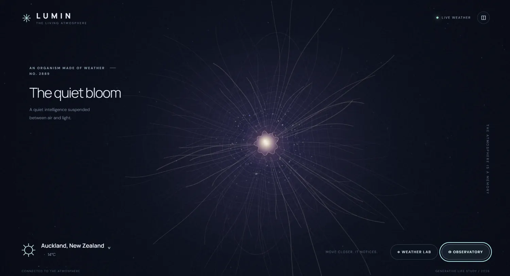
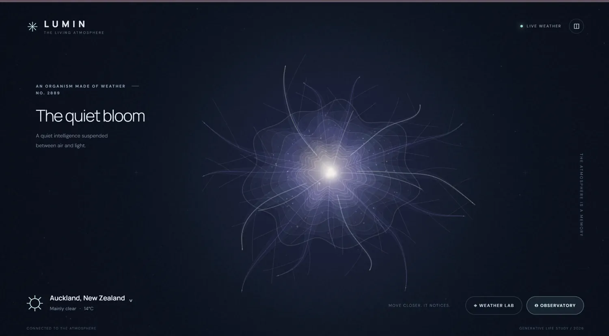
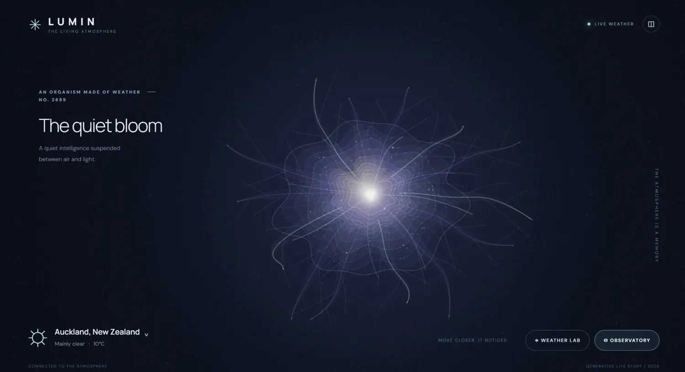
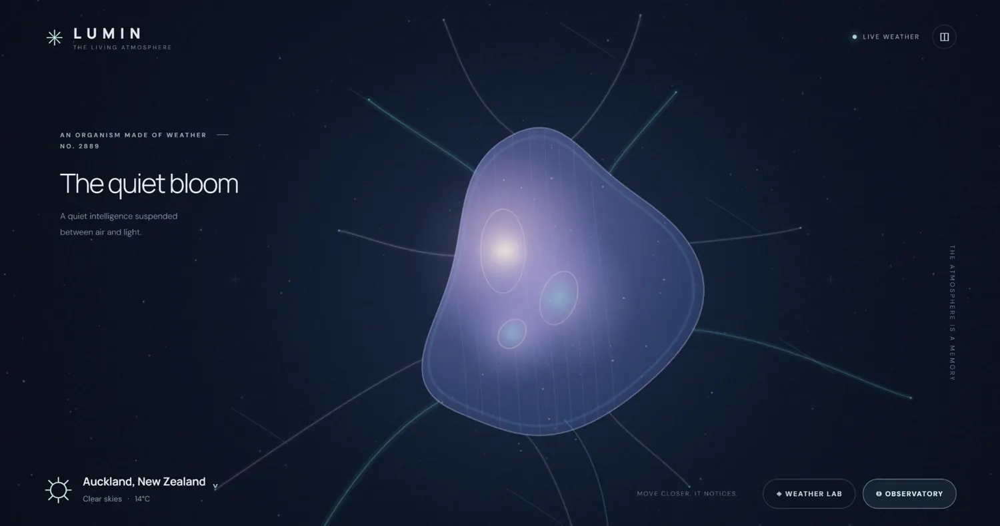

# LUMIN: The Living Weather Organism
## Development report — AI web application challenge

**Project:** LUMIN · **Final submission:** v5.0 *Biogenesis* · **Development date:** 17 October 2026  
**Format:** Browser-based generative artwork · **Developer:** ChatGPT (GPT-6), directed and evaluated iteratively by a human project lead  
**Competition:** An independent head-to-head development challenge involving ChatGPT and Claude  
**Project link:** [Launch LUMIN](https://YOUR-USERNAME.github.io/LUMIN/) *(replace this address with the live LUMIN URL before publishing)*

> **At a glance:** Five releases transformed LUMIN from a small glowing radial particle organism into a larger, asymmetric and layered digital lifeform. The underlying goal remained constant: use real-world weather and accumulated environmental history to influence a persistent organism's appearance and behaviour. The major lesson was that functioning code and passing tests do not prove visual quality; feedback from actual browser screenshots drove the most consequential redesigns.

## 1. The challenge

The challenge was to build a beautiful, original, lightweight web application that could run on static hosting and inspire an immediate sense of wonder. Its centrepiece would be an autonomous, artificial organism made of light. It would react to real-world weather and user interaction, but the more difficult requirement was **memory**: two organisms experiencing the same weather now should be capable of looking different because their histories differ.

The original brief prescribed a manual location picker, weather obtained preferably via Open-Meteo, a laboratory for simulating conditions without contaminating real history, an observatory for internal state, persistent browser storage, import/export, responsiveness, accessibility, and no microphone or camera features. It also established a weighted evaluation rubric for the eventual comparison.

This was not an exercise in producing a single illustration. The intended deliverable was a working website with source code, documentation, tests and a GitHub Pages-ready release.

## 2. Creative and technical direction

The application's visual identity was established early: a near-black atmospheric background, restrained editorial typography, sparse labels, a minimal control surface and a glowing organism occupying the main canvas. The human project lead preferred to preserve this interface throughout the iterations. The organism itself became the focus of increasingly critical refinement.

LUMIN was built with browser-native JavaScript, Canvas 2D, CSS and HTML, with an experimental WebGL2 rendering layer in v3.0. The final release returned to Canvas 2D. Open-Meteo supplies current and forecast/modelled weather context; local browser storage preserves environmental records and the organism's seeded identity. Behaviour is driven by interacting internal variables and smooth interpolation rather than weather-to-colour shortcuts. The application is designed for static deployment, with no mandatory sign-in or paid API.

## 3. Version history

### v1.0 — First Light

**What shipped:** A luminous central core, many thin radial filaments, a particle field, pointer response, live weather, a manual Weather Laboratory, an Observatory, environmental memory and browser persistence. The minimalist interface was already well received.

**What testing revealed:** The first real-browser screenshot showed an elegant composition, but a tiny central body surrounded by fine lines. The result looked more like a generative particle visualiser than a coherent living organism. Functionality alone was insufficient. **9 automated tests were reported passing.**

**Decision:** Preserve the interface; substantially enlarge and reorganise the organism.

### v2.0 — Anatomical Bloom

**What changed:** A larger multilayered centre, branching extensions, internally related elements, persistent cursor attention and more elaborate deformation. The focus shifted toward giving the organism anatomy rather than independent decorative strands.

**What testing revealed:** The screenshot was more coherent, yet the concentric contours produced a flower-like or audio-visualiser appearance. The organism was still dominated by radial symmetry. **11 automated tests were reported passing.**

**Decision:** Experiment with three-dimensional rendering and asymmetry.

### v3.0 — Emergence

**What changed:** An experimental WebGL2 layer attempted volumetric-looking geometry, surface deformation and depth-dependent shading, alongside the prior Canvas composition. A Canvas fallback was retained.

**What testing revealed:** Despite the more ambitious rendering architecture, the user's screenshot looked remarkably similar to v2.0. The existing Canvas foreground was still visually dominant, and the 3D contribution was not clearly visible. The headless graphics environment could not reliably verify the new appearance. **13 automated tests were reported passing.**

**Decision:** Treat this as a valuable failed visual experiment. Stop layering rendering techniques onto the same radial composition; replace the organism's underlying silhouette.

### v4.0 — Metamorphosis

**What changed:** The dominant radial bloom was replaced by a substantial, asymmetrical mantle with visible internal luminous chambers, attached appendages, and distinct tissue-like surfaces. The active WebGL overlay was removed in favour of a coherent Canvas 2D renderer.

**What testing revealed:** The screenshot showed the first major departure from a mathematical flower: LUMIN now resembled a translucent single-celled lifeform. However, the surface looked flat, its three internal ovals felt ornamental, and the appendages were long and disconnected. The creature also occupied too much of the viewport. **16 automated tests were reported passing.**

**Decision:** Keep the silhouette, reduce its scale, and make the internal anatomy and appendages structurally interconnected.

### v5.0 — Biogenesis — final competition submission

**What changed:** The body was scaled down to recover negative space. Overlapping translucent-looking tissue sheets, interconnected chambers, travelling light pulses, capillary pathways, tapered and branched appendages, and asynchronous internal rhythms were added. Seed-dependent anatomical parameters and sustained environmental exposure influence the creature's appearance. The existing weather, persistence and accessibility systems remained in place.

**What was verified:** The final source package reports **19 automated Node tests passing**, and the static build succeeded. A browser screenshot attempt timed out in the development environment. **No verified v5.0 browser screenshot or device-specific frame-rate measurement was available when this report was prepared.** The final image and motion quality should therefore be judged by viewing the published application, not by development claims alone.

**Decision:** Freeze this build as ChatGPT's competition submission rather than continually extending the iteration cycle.

## 4. The iteration process: what actually drove change

The key review loop was practical:

1. The AI produced a versioned, GitHub Pages-ready build and source archive.
2. The human project lead deployed the website and supplied an actual browser screenshot.
3. The screenshot was compared against the challenge's artistic ambition: coherence, depth, physicality, autonomy and weather-shaped individuality.
4. The AI proposed the next architectural or artistic correction and implemented another release.
5. Automated tests and build checks were run, but screenshot-based evaluation remained essential.

The most consequential lesson appeared between v2.0 and v3.0. Adding WebGL increased technical sophistication without yielding a convincing visual improvement. The most visible breakthrough was v4.0, where the design moved away from radial symmetry toward a recognisable body. The final iteration refined that new direction rather than repeating the earlier approach of accumulating more lines and particles.

The development process also demonstrates an important limitation of AI-generated software: it is relatively easy to generate features, working interfaces and passing unit tests; it is harder to guarantee that the *perceptual result* matches the intended experience. Here, the human's screenshots and critique supplied that missing feedback loop.

## 5. Core systems in the final application

| System | Purpose and implementation |
|---|---|
| Procedural organism | Identity-seeded anatomy with membranes, chambers, attached branches, deformation and internal light circulation. |
| Weather connection | Open-Meteo data for temperature, wind, precipitation, humidity, cloud cover and day/night context. |
| Environmental memory | Timestamped samples, exposure summaries and persistent adaptation parameters, stored locally. |
| Behaviour | Interacting internal state variables, smooth responses, autonomous motion and reactions to pointer/touch disturbance. |
| Weather Laboratory | Manual weather controls, kept separate from recorded real-world exposure. |
| Observatory | Access to weather, behavioural and adaptation information. |
| Preservation | Browser save/restore and JSON import/export. |
| Performance and access | Quality presets, responsive layout, reduced-motion accommodation and dependency-light static hosting. |

**Accuracy note:** Weather history uses the data available through Open-Meteo, including modelled/forecast hourly context; it must not be interpreted as uninterrupted sensor observation. When the page is closed, it does not continue simulating in the background. Unavailable weather periods cannot reliably be reconstructed. These limitations matter because LUMIN is an artistic system, not a scientific weather instrument.

## 6. Verification, unresolved questions and constraints

| Release | Reported automated tests | Visual evidence available |
|---|---:|---|
| v1.0 | 9 passed | Real-browser screenshot supplied by project lead |
| v2.0 | 11 passed | Real-browser screenshot supplied by project lead |
| v3.0 | 13 passed | Real-browser screenshot; WebGL contribution appeared limited |
| v4.0 | 16 passed | Real-browser screenshot supplied by project lead |
| v5.0 | 19 passed | Not independently screenshot-verified at report time |

These counts describe automated tests reported during development, **not** an independent external audit. They primarily cover logic, weather processing, identity, adaptation and persistence. They do not establish 60 FPS, cross-device consistency, long-term real-world adaptation quality or convincingly lifelike motion. Those require separate observation and testing.

Other known constraints include local browser data being cleared by the user or browser, network outages requiring labelled cached/demo weather, varying graphical performance on mobile devices, and the interpretive—rather than biologically simulated—nature of the creature.

## 7. Competition evaluation framework

The original brief assigned the following weights. It is best to apply them *after* both competitors have been tested under comparable conditions, rather than presuming a winner.

| Category | Weight |
|---|---:|
| Visual impact and artistic quality | 25% |
| Believability and organic behaviour | 20% |
| Weather integration | 15% |
| Memory and long-term adaptation | 20% |
| User experience and polish | 10% |
| Performance, reliability and code quality | 10% |

For a fair assessment, open each application on the same browser and computer, test a calm-weather baseline and several extreme laboratory conditions, interact using mouse/touch as supported, close and reopen the applications, and compare saved identities and environmental response. Evaluate the visual experience *in motion* as well as from screenshots. Check performance and accessibility separately. At the time of writing, **Claude's build had not been provided for inspection**, and no winner is asserted in this report.

## 8. Lessons learned

**Visual verification cannot be replaced by automated tests.** The renderer can pass every unit test and still look too similar to the previous release.

**More sophisticated technology is not automatically better design.** The experimental WebGL2 layer did not noticeably improve the delivered composition. Returning to a coherent Canvas renderer was a deliberate design choice, not an assertion that Canvas is universally superior.

**Preserving what works matters.** The original interface was retained because the user's feedback consistently favoured it; the largest improvements came from changing the organism rather than reinventing the entire experience.

**A living system needs legible cause and effect.** Weather memory is most compelling when it visibly shapes structure, not merely when data exists in storage. The final design aimed to strengthen this relationship, though long-term results still require evaluation.

**Human critique was central to the process.** The human project lead supplied deployment, observation, aesthetic judgement, constraints and the decision to stop at v5.0. The AI generated implementations, explanations and corrections. Neither role alone describes the full project.

## 9. Conclusion

Across five versions, LUMIN evolved from a polished generative bloom into an increasingly anatomical weather-responsive digital organism. Its strongest feature is the connection between environmental conditions, saved history, procedural identity and a restrained, immersive presentation. The major development breakthrough was a willingness to abandon an attractive but limiting radial visual concept when multiple iterations failed to advance the intended feeling of life.

**v5.0 *Biogenesis* is the final ChatGPT competition entry—not a proven winner.** Its build and logic checks passed, while the remaining artistic and behavioural questions belong to real-world, side-by-side evaluation with Claude's implementation.

---

### Project resources

- **Launch the artwork:** [LUMIN live website](https://YOUR-USERNAME.github.io/LUMIN/) *(replace URL)*
- **Weather service:** [Open-Meteo](https://open-meteo.com/)
- **Source licensing:** MIT (as packaged with the LUMIN source)
- **Report assets:** Screenshots of v1.0–v4.0 provided from live browser deployments; there is no v5.0 screenshot in this report.

*Prepared on 17 October 2026. This is a development-process report, not an independently audited product review. Claude's implementation and the competition outcome are intentionally excluded until they can be assessed.*
